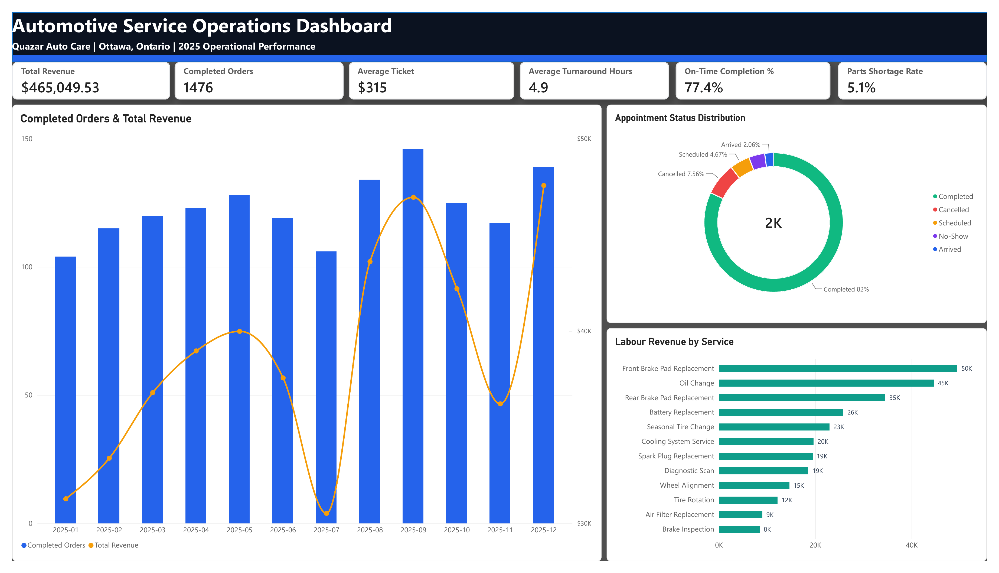
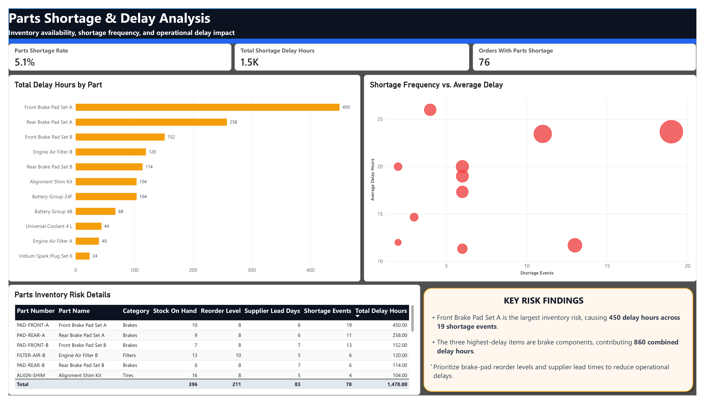
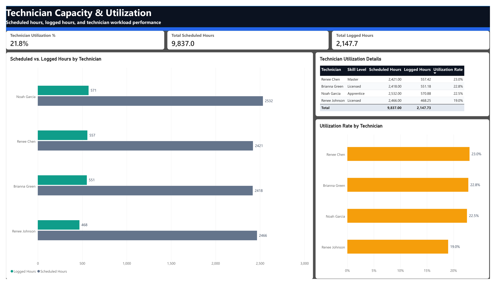

# Automotive Service Operations SQL Analysis

An end-to-end SQL Server, Python, and Power BI portfolio project that models the 2025 operations of **Quazar Auto Care**, a fictional automotive service business in Ottawa, Ontario.

The project converts a normalized operational dataset into decision-ready reporting on revenue, appointment demand, turnaround performance, parts shortages, and technician capacity. All data is synthetic, deterministic, and created solely for demonstration.



## Business Problem

Service managers need one reliable view of how demand, repair performance, inventory constraints, and technician capacity affect the business. This analysis answers five practical questions:

1. When is appointment demand highest?
2. How are completed orders, revenue, turnaround time, and on-time performance trending?
3. Which services generate the most volume and labour revenue?
4. Which parts shortages create the greatest operational delay?
5. How do scheduled and logged technician hours compare?

## Solution Architecture

The project follows a reproducible analytics workflow:

1. Generate deterministic synthetic operational data with Python.
2. Validate relationships, timestamps, financial totals, and business rules.
3. Load normalized CSV data into SQL Server.
4. Create reporting views and run reusable T-SQL analysis queries.
5. Connect Power BI to the reporting layer and calculate presentation metrics in DAX.
6. Present the results in a three-page executive dashboard.

## Technology Stack

| Layer | Tools and techniques |
|---|---|
| Data generation and QA | Python, pandas, deterministic random seed, 23 automated checks |
| Database | Microsoft SQL Server, normalized relational design, PK/FK/UNIQUE/CHECK constraints, indexes |
| Analysis | T-SQL joins, CTEs, conditional aggregation, window functions, rolling totals, `PERCENTILE_CONT`, `DENSE_RANK` |
| Reporting | Five SQL reporting views, Power BI, DAX |
| Presentation | Three-page executive dashboard with semantic colours and KPI cards |

## Dataset

The model covers one service location from **2025-01-01 through 2025-12-31**.

| Entity | Rows | Entity | Rows |
|---|---:|---|---:|
| Customers | 400 | Vehicles | 516 |
| Appointments | 1,800 | Repair orders | 1,513 |
| Repair-order services | 2,024 | Technician time logs | 2,024 |
| Part-usage records | 2,828 | Parts shortages | 78 |
| Technician shifts | 1,157 | Completed repair orders | 1,476 |

The schema contains 12 normalized tables. See the [entity relationship diagram](docs/erd.md) and [data dictionary](docs/data_dictionary.md) for full definitions.

## Dashboard Pages

### 1. Operations Overview

Tracks completed-order revenue, completed orders, average ticket, turnaround time, on-time completion, appointment status, and labour revenue by service.


### 2. Parts Shortage & Delay Analysis

Ranks parts by total delay, compares shortage frequency with average delay, and highlights the highest-priority inventory risks.



### 3. Technician Capacity & Utilization

Compares scheduled and logged hours and shows utilization by technician.



The complete dashboard is available as a [PDF export](dashboard/Automotive_Service_Operations_Dashboard.pdf) and an editable Power BI file in the `dashboard` folder.

## Key Findings

- **$465,049.53** in completed-order revenue across **1,476 completed orders**, producing an average completed ticket of **$315.07**.
- Average completed-job turnaround was **4.93 hours**, with a **77.37%** on-time completion rate.
- **Friday** was the busiest weekday with **410 appointments**.
- **Oil Change** was the most common service with **485 service lines**.
- Orders without a shortage averaged **3.89 hours** of turnaround; orders with a shortage averaged **24.03 hours**.
- **Front Brake Pad Set A** created the largest inventory impact: **19 shortage events** and **450 delay hours**.
- **Renee Chen** recorded the highest direct-labour utilization at **23.02%** of scheduled hours.

See [analysis findings](findings/analysis_findings.md) for recommendations, definitions, and limitations.

## Data Quality

The validation script performs **23 checks** covering:

- duplicate primary keys and orphaned foreign keys;
- appointment, repair, shortage, and time-log timestamp order;
- vehicle/customer ownership consistency;
- overlapping technician time logs;
- positive part quantities and non-negative monetary values;
- reconciliation of labour, parts, tax, and repair-order totals.

Current result: **PASS — 0 issues**. Machine-readable results are stored in [`findings/data_quality_results.json`](findings/data_quality_results.json).

## Repository Structure

```text
automotive_service_operations_sql_analysis/
├── dashboard/       # PBIX, PDF, screenshots, DAX, and build notes
├── data/            # Deterministic synthetic CSV datasets
├── docs/            # ERD, data dictionary, and interview walkthrough
├── findings/        # Analysis narrative and validation outputs
├── scripts/         # Data generation, validation, loading, and analysis
├── sql/             # Ordered SQL Server setup and analysis scripts
├── .gitignore
├── README.md
└── requirements.txt
```

## Reproduce the Project

### 1. Set up Python

```bash
python -m venv .venv

# Windows PowerShell
.venv\Scripts\Activate.ps1

pip install -r requirements.txt
```

### 2. Generate and validate the data

The repository already includes the generated CSV files. Regenerate them at any time with the fixed seed:

```bash
python scripts/generate_synthetic_data.py
python scripts/validate_dataset.py
python scripts/analyze_dataset.py
```

### 3. Build the SQL Server database

Run these scripts in SQL Server Management Studio in order:

1. `sql/01_create_database.sql`
2. `sql/02_create_tables.sql`

Then load the CSV files. Replace the server name with your SQL Server instance:

```bash
python scripts/load_to_sql_server.py --server "localhost\SQLEXPRESS"
```

The loader uses Windows authentication by default. For SQL authentication, set `QUAZAR_SQL_USER` and `QUAZAR_SQL_PASSWORD`, then add `--sql-auth`.

Finally, run:

3. `sql/03_validation_checks.sql`
4. `sql/04_reporting_views.sql`
5. `sql/05_analysis_queries.sql`

### 4. Open the dashboard

Open `dashboard/Automotive_Service_Operations_Dashboard.pbix` in Power BI Desktop. If the SQL Server instance differs from the original environment, update the data-source settings and refresh the model. The supporting DAX is documented in [`dashboard/power_bi_measures.dax`](dashboard/power_bi_measures.dax).

## Metric Definitions

- **Total Revenue**: value of completed repair orders; this matches the Power BI KPI.
- **Total Recorded Order Value**: value of all repair orders regardless of status.
- **Average Ticket**: completed-order revenue divided by completed orders.
- **Technician Utilization**: direct repair hours logged divided by scheduled shift hours; administrative work and idle time are not included.
- **Parts Shortage Rate**: completed orders with at least one shortage divided by completed orders.

## Limitations

- The data is synthetic and represents a fictional single-location business.
- Results demonstrate analytical methods and do not establish real-world causal relationships.
- Technician utilization measures direct logged repair time, not total employee productivity.
- Shortage delays were intentionally simulated to support inventory-risk analysis.

## Additional Documentation

- [Power BI build guide](dashboard/power_bi_build_guide.md)
- [Interview walkthrough](docs/interview_walkthrough.md)
- [Entity relationship diagram](docs/erd.md)
- [Data dictionary](docs/data_dictionary.md)
- [Analysis findings](findings/analysis_findings.md)

---

Created as a SQL and business intelligence portfolio project by **Shaquille Thomas**.
