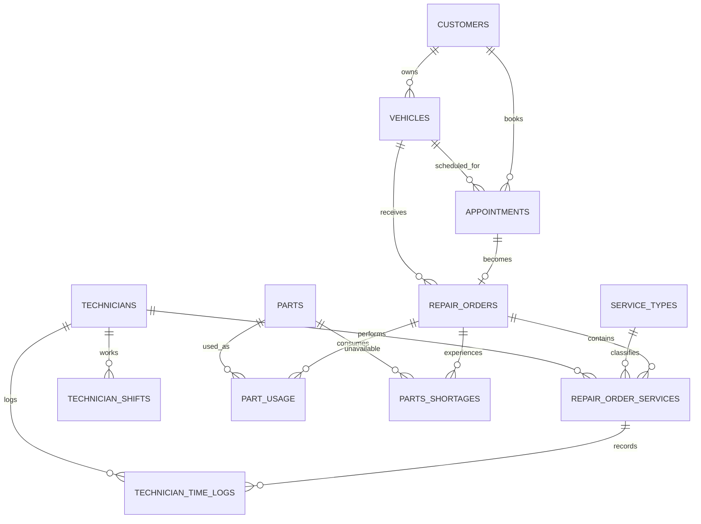

# Entity Relationship Diagram

## Design Choices

- Customers and vehicles are separated because one customer may own multiple vehicles.
- Appointments represent planned demand; repair orders represent work that actually entered the shop.
- RepairOrderServices resolves the many-to-many relationship between repair orders and service types.
- TechnicianTimeLogs are separated from service assignment so scheduled responsibility and recorded labor can be compared.
- PartUsage records actual consumption, while PartsShortages records inventory failures and their operational delay.
- Monetary values are stored on the transaction rows to preserve the price or cost used at that time.
